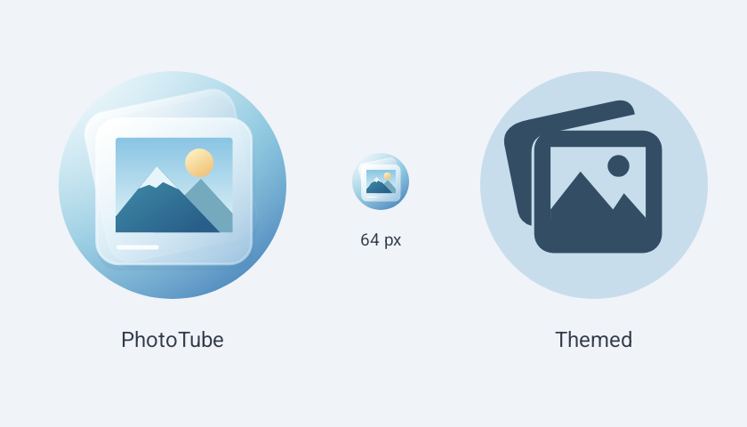

# PhotoTube 应用图标

冰蓝渐变背景，叠放的半透明照片卡片，雪山与暖色太阳。使用原生 VectorDrawable 渐变和分层表达玻璃质感，保持小尺寸识别度。

- Manifest 的 icon 和 roundIcon 均使用同一个 adaptive icon，由桌面决定圆形、圆角方形等外轮廓。
- 背景、前景分离，另提供 monochrome 图层，由系统决定主题图标颜色。
- 桌面图标是静态矢量素材，不具备应用内的实时背景折射。
- AppIconTest 从已安装应用读取真实图标，检查 adaptive / monochrome，并生成设备实际蒙版下的预览。

