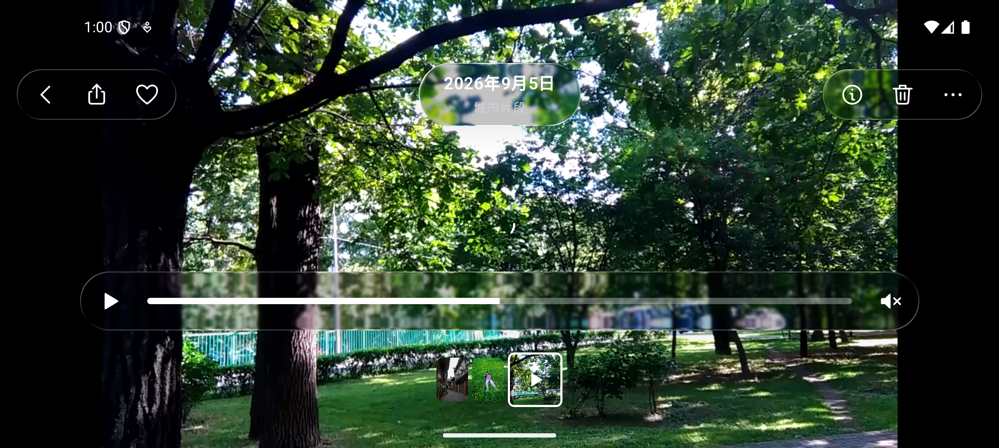

# 相册、照片与视频详情

## 入口和交互

- 图库中的照片和视频打开统一全屏查看器；详情顺序继承当前筛选和排序。相册封面进入独立网格页，内容按当前相册范围浏览。
- 相册详情支持日期排序切换、两列/三列缩略图、收藏标识、视频时长和删除后的撤销。
- 照片支持左右分页、缩略图跳转、单击隐藏/显示控件、双击放大/还原、双指缩放（1–5 倍）、放大后平移并限制边界。
- 未放大时向下拖动，背景随手指渐隐；拖动不足回弹，超过屏幕高度的 15% 退出。上滑超过 10% 打开信息。放大时竖向手势用于平移照片，不触发退出。
- 打开/退出使用实际缩略图矩形到媒体适应屏幕矩形的弹簧过渡；目标缩略图不在屏幕内时退化为原位淡出。关闭 Android Dialog 自带动画，避免双重过渡。
- 底部为分享、收藏/信息玻璃胶囊、删除；缩略图带随当前页更新宽度和选中标记。横屏隐藏缩略图带以留出观看空间。
- 视频自动静音播放，支持播放/暂停、连续拖动进度、音量开关和 0.5/1/1.5/2 倍速；播放时 4.5 秒后隐藏控件，点击画面恢复。缓冲、失败重试、播放结束、退后台、混合媒体切换均有对应状态处理。
- 信息显示资源的实际分辨率、文件大小、视频时长。标题和日期为演示数据；不伪造相机、GPS、EXIF 信息。
- 分享使用 Android 系统选择器和只读 FileProvider 授权，用户自行选择目标；删除只移除当前演示会话的素材，支持撤销，不删除资源文件。

## 实现边界

`ui/media/GalleryMedia.kt` 定义统一媒体模型和元数据/封面缓存。视频封面只取一次用于列表和过渡；实时玻璃完全通过 TextureView 的画面渲染，不轮询视频帧。

`VideoPlayback.kt` 管理播放器生命周期，仅当前视频创建 ExoPlayer；切换照片或退出即释放，后台暂停。播放进度每 200ms 更新一次 UI 数字，不参与画面采样。配置重建保存当前媒体、分页、播放意图、音量、速度和最近进度。

`PhotoGestures.kt` 分离单击、双击、缩放、拖动和 Pager 的水平滑动。放大状态只在移动超过 touch slop 时消费事件，避免吃掉双击还原。

`MediaViewer.kt` 负责页面编排、矩形过渡和玻璃控件。`MediaIcons.kt` 使用统一 24 单位网格、1.7 单位圆头描边绘制详情图标。颜色读取现有 AppTheme/MediaColors，玻璃使用项目里的 AndroidLiquidGlass。

当前查看器已接入后端认证媒体、连续分页、收藏、回收站及非破坏编辑；本地资源仅用于演示和隔离测试。删除进入服务端回收站，恢复通过回收站进行，不使用旧演示的本地撤销。

## 验证

`RemoteMediaGestureTest` 通过隔离 HTTPS 服务运行真实主界面，覆盖分页与缩略图切换、收藏写入和重开、双击/双指缩放、短拖回弹/长拖退出、相册缩略图尺寸、照片信息、取消删除、视频横滑 seek、暂停/进度/静音/倍速/重进、横屏及系统分享选择器（不实际发送）。7 项通过，lint 通过，日志 `/tmp/phototube-media-album.log`。

配置重建及跨页恢复由 `ConfigurationRestoreTest` 覆盖；服务端删除后跨模块刷新由 `CrossModuleRefreshTest` 覆盖；可恢复删除的恢复和部分失败由 `TrashTest` 覆盖。相关联合 16 项通过，日志 `/tmp/phototube-media-final.log`。旧 `MediaViewerTest` 已迁移并删除。

导航与搜索由 `RemoteNavigationUiTest`、`RemoteSearchUiTest` 覆盖，主题由 `ThemeTest` 覆盖。历史本地实验 `VideoGlassTest` 的结果不等同于真实长视频性能验收。

参考：[Apple iOS 26 照片与视频查看](https://support.apple.com/zh-cn/guide/iphone/iph3d267610/26/ios/26)、[Compose Pager](https://developer.android.com/develop/ui/compose/layouts/pager)、[Compose 手势](https://developer.android.com/develop/ui/compose/touch-input/pointer-input/understand-gestures)、[Media3 视频表面类型](https://developer.android.com/media/media3/ui/surface)。

## 视频播放器参考调整

横屏采用左侧返回/分享/收藏、居中日期、右侧信息/删除/更多的玻璃分组。播放、进度与静音共用一条胶囊，进度拖动优先捕获手势，避免穿透触发翻页；时间仅在拖动时显示。横屏保留媒体缩略图以便连续切换。暂未实现视频编辑，不放置无功能的调节按钮。

### 视频等待期间的播放意图

播放/暂停按钮以用户期望的 wantsPlay 为准，缓冲时仍可暂停，不用瞬时 isPlaying 反推操作。VideoBufferingTest 验证延迟视频首帧前暂停、到帧后进度不推进，以及重建后保留暂停状态。实际 playing 继续决定帧进度刷新和工具栏自动隐藏。联合 14 项回归、加强断言后单项回归及 lint 通过，见 backend-parity 最新记录。

视频失败重试回归：VideoBufferingTest 验证 2 秒处暂停、声音开启、1.5× 后重建遇到视频 404，恢复服务并手动重试能出帧，位置与三个偏好保留。相关 3 项回归及 lint 通过（/tmp/phototube-video-retry.log）；不代表播放中任意断流或长视频持续播放已验证。

系统因永久焦点丢失或音频输出断开而暂停时，同步取消 wantsPlay，避免返回前台意外续播。VideoBufferingTest 通过真实 AudioManager 焦点竞争验证暂停按钮、前后台保留与手动续播；相关 16 项回归及 lint 通过（/tmp/phototube-video-focus-final.log）。耳机断开的相同回调分支已处理，但模拟器保护广播不能替代真实硬件验收。

### GIF 原图

共享 Coil ImageLoader 注册官方 AnimatedImageDecoder（coil-gif 与已有 Coil 同为 3.6.0）。GIF 原图可播放动画，缩略图仍来自后端派生接口。AnimatedPhotoTest 检查真实屏幕上两帧颜色变化；大图/BMP 3 项和私密/手势 17 项回归及 lint 通过，见 backend-parity 最新记录。

### 原图版本一致性

原图请求 URL 保持契约不变，内存缓存键包含最新 contentHash；更新哈希后重新加载，同版本继续复用。详情明确为空哈希时不采用旧列表哈希，当前请求禁用内存缓存。OriginalVersionCacheTest 验证实际红/绿原图切换与请求次数；联合 14 项、最终空哈希/大图/编辑 5 项及 lint 通过，见 backend-parity 记录。
